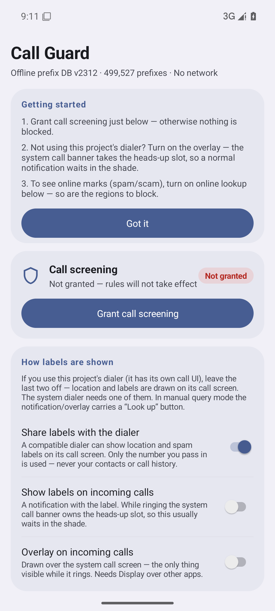
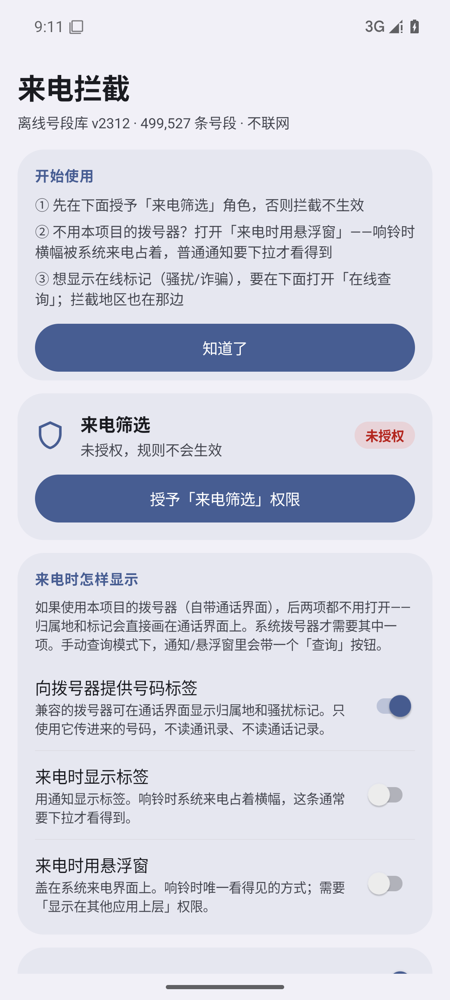
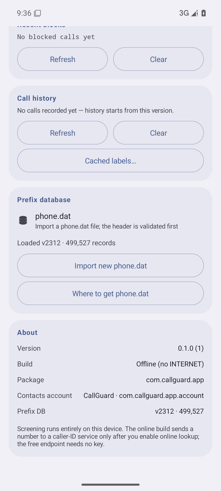

# CallGuard · 按归属地拦截来电

CallGuard 是一个默认完全离线的来电筛选工具：按号码归属地（省/市/运营商）决定拒接或静音，拦截动作交给 Android Telecom 执行。不需要 root，不上传通话内容。

> **主要面向中国大陆手机号（+86）。** 号段库、省份/城市和运营商判断都基于中国大陆的 7 位号段；境外号码只按「国际来电」开关处理，不做归属地识别。

- Android 13+（API 33），需要系统支持「来电筛选」（Call Screening）角色
- 离线包**没有 INTERNET 权限**；在线包的在线查询默认关闭
- 公开版**不附带号段库**，`phone.dat` 由用户自行获取并导入
- 开源，GPL-3.0

<p align="center">
  
  
</p>

## 下载与安装

到本仓库的 [Releases](../../releases/latest) 下载 APK。两个版本功能相同，只有网络权限不同：

| 文件 | INTERNET | 说明 |
|---|---|---|
| `CallGuard-0.1.0.apk` | 无 | 推荐；所有判定都在本机完成 |
| `CallGuard-0.1.0-online.apk` | 有 | 可选在线号码标记；默认关闭 |

两个包都**不含** `phone.dat`。

安装步骤：

1. 安装 APK（系统可能要求允许「安装未知应用」）。
2. 打开 CallGuard，点「授予来电筛选权限」，在系统页面把「来电筛选」角色交给 CallGuard。
3. 导入号段库（见下一节）。不导入也能用，但只能按未知号段/国际来电等规则判断，**无法按省市拦截**。
4. 在「地区」里选择要拦截的省/市，并打开「启用拦截」。

> 如果使用系统拨号器，建议再打开「来电时用悬浮窗」或「来电时显示标签」；系统来电横幅会占满 Heads-up 通知位，普通通知通常要下拉才能看到。

## 号段库（不随应用分发）

公开仓库和 APK 都**不包含** `phone.dat`。需要离线归属地时，请自行获取：

- [xluohome/phonedata](https://github.com/xluohome/phonedata)（GPL-3.0，仓库根目录的 `phone.dat`）
- 其他同格式来源也可以；应用会校验文件结构，不限制来源

获取后在应用内点「导入新版 phone.dat」→ 选择文件（SAF，不需要存储权限）→ 应用会校验头部、记录排序和内容偏移，再复制到自己的私有目录。导入的文件不会上传，也不会写进 APK。

<p align="center">
  
</p>

格式（小端）：

```text
头部   4s version (4 chars) | int32 first_record_offset
记录   int32 prefix (7 digits) | int32 content_offset | uint8 carrier   xN
内容   "province|city|zip|area_code\0"
carrier  1 移动  2 联通  3 电信  4 电信虚拟  5 联通虚拟  6 移动虚拟  7 广电  8 广电虚拟
```

> 数据由用户自行获取，应用不重新分发。号段分配本身是公开事实；如果要随产品分发数据，请先确认数据源的许可证。

## 功能

- 按**省/市**或**全省**拦截，选中地区命中即拦
- 通讯录里的人始终放行（只统计用户自己存的联系人，CallGuard 写入的标签账户不算）
- 国际来电、隐藏号码、未知号段、虚拟运营商可分别设置放行/拦截
- 700 开头的 15 位隐私号（快递/外卖/网约车）默认放行，也可改为静音
- 短号/特服号（10086、95588、110 等）一律放行
- 拦截动作可选**直接拒接**（忙音）或**静音**（不响铃、不显示，对方听正常回铃）
- 本地拦截日志（最多 300 条）、通话历史、号码查询测试
- 可把归属地/标记写进系统通讯录，或提供给兼容拨号器显示
- 中英文界面，跟随系统深/浅色和 Material You 取色

## 隐私

- 离线包没有 `INTERNET` 权限，号码只在内存、通讯录和本地号段库里查询
- 在线包只有在你打开「在线查询」后才会联网；查询模式可选手动、来电时确认或自动。**查询会把号码发送给第三方标记服务**，拦截判定从不联网
- 填了自己的 Tmini Key 走付费聚合接口；不填则使用 kit9 的免费接口，稳定性和隐私政策由对应服务决定
- 号段库、规则、日志都保存在应用私有目录
- 可选权限及用途：
  - `READ_CONTACTS` / `WRITE_CONTACTS`：通讯录放行、把标签写入通讯录（授权时才申请）
  - `READ_CALL_LOG`：只用于判断刚刚是否打过紧急电话，避免拦截紧急回拨
  - `POST_NOTIFICATIONS`、`SYSTEM_ALERT_WINDOW`：来电标签/悬浮窗（默认关）
  - 账户与同步权限：仅用于 CallGuard 自己的通讯录账户

## 构建

不需要 Gradle / Android Studio。依赖 JDK 17+、Android SDK（build-tools + platform 36）：

```powershell
git clone <仓库地址>
cd callguard

$env:JAVA_HOME = 'C:\path\to\jdk'
$env:ANDROID_HOME = 'C:\path\to\android-sdk'

# 离线版，不打包 phone.dat
.\build.ps1 -NoDb

# 在线版（加 INTERNET 权限）
.\build.ps1 -Online -NoDb
```

输出：

- `CallGuard-nodb.apk`
- `CallGuard-online-nodb.apk`

版本号可以覆盖：

```powershell
.\build.ps1 -NoDb -VersionName 0.1.0 -VersionCode 1
```

`-SelfTest` 会导出 `SelfTestReceiver`，只用于 `adb broadcast` 联调；公开发布不要加这个参数。

构建链：`aapt2 compile → aapt2 link → javac → d8 → 塞 classes.dex → zipalign → apksigner`。界面全部用代码构建，没有 XML 布局，也没有 AndroidX。

### 签名

首次构建会在项目根目录生成 `callguard.keystore`。密码通过环境变量传入：

```powershell
$env:CG_KS_PASS = 'your-strong-password'
.\build.ps1 -NoDb
```

不要把 keystore 或密码提交到仓库。公开 release 的签名证书 SHA-256：

```text
fdf85b711698095b0be8481db59f9fc6a193d4d93cc94161faf4666a3a384e11
```

可以用 `apksigner verify --print-certs CallGuard-0.1.0.apk` 核对。

## 已知限制

- 主要面向中国大陆 +86 号码；境外号码不做归属地识别
- 「来电筛选」角色由系统决定；部分 ROM 可能不提供或默认交给系统拨号器
- 系统黑名单在 CallGuard 上游：被系统拉黑的号码不会送到这里
- 公开版不带号段库，首次使用需要自己导入
- 在线标记依赖第三方 API；默认关闭，开启后会把号码发给对应服务
- 不是 Play Store 应用；通过 GitHub Releases 分发

## 许可证

代码以 [GPL-3.0](LICENSE) 发布，版权声明见 [NOTICE](NOTICE)。`phone.dat` 不在本仓库内，其许可证由数据来源决定（推荐来源为 GPL-3.0）。
